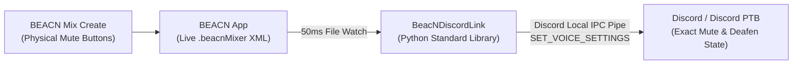

# BeacNDiscordLink 🎙️🔗🎧

**BeacNDiscordLink** is a lightweight, zero-dependency Windows bridge that automatically syncs the physical **Mute buttons** on your **BEACN Mix Create** with your in-app **Discord Mute & Deafen** status.

---

## Why Does This Exist?

When you press the physical **Mic Mute** button on your **BEACN Mix Create**, the BEACN hardware/software cuts your microphone audio feed before it reaches Discord. However, **Discord itself doesn't know you pressed the button on your mixer**—so the red **Muted** or **Deafened** icon next to your name in Discord voice channels never turns on, leaving your friends wondering if you can hear them or why you stopped talking.

**BeacNDiscordLink** solves this automatically in real time:

| Physical BEACN Mix Create State | Discord Voice Status | What People in Discord See |
| :--- | :--- | :--- |
| **Mic** = Live, **Chat** = Live | **Unmuted & Undeafened** | Normal (Live) |
| **Mic** = Muted, **Chat** = Live | **Mic Muted** (`mute: true, deaf: false`) | Red Microphone Slash Icon 🎙️🚫 |
| **Mic** = Muted, **Chat** = Muted | **Deafened** (`mute: true, deaf: true`) | Red Headset Slash Icon 🎧🚫 |

---

## How It Works (Simple & Reliable)



1. **Non-Intrusive BEACN Detection:**
   - Whenever you press a button on the **BEACN Mix Create**, the **BEACN App** immediately updates the live `<mixerTree>` state inside your active `.beacnMixer` profile file (`Documents\BEACN\profiles\MixerProfiles\<Profile>.beacnMixer`).
   - **BeacNDiscordLink** auto-discovers your active profile from `%APPDATA%\BEACN\lastLoaded.profiles` (supporting both standard `Documents` and `OneDrive\Documents`) and watches the `buttonMuteState` of your **Mic** and **Chat** knobs.
   - Because it reads the live state without opening a competing USB handle, it **never conflicts** with the BEACN App and **does not require Administrator privileges**.

2. **Exact State Sync via Discord Local RPC (Never Gets Out of Sync):**
   - Instead of simulating keyboard shortcuts (which are blind toggles that easily get inverted/out-of-sync if you click Mute inside Discord), **BeacNDiscordLink** talks directly to Discord's local IPC pipe (`\\.\pipe\discord-ipc-0`, `discord-ipc-1`, etc.).
   - It sends explicit `SET_VOICE_SETTINGS` commands (`{"mute": true/false, "deaf": true/false}`), ensuring Discord always matches your BEACN Mix Create 100% of the time.
   - Supports **Discord (Standard)**, **Discord PTB**, and **Discord Canary** simultaneously.

---

## Quick Start (3 Easy Steps)

### Prerequisite
- **Windows 10 / 11** with the **BEACN App** and **Discord** running.
- **[Python 3](https://www.python.org/downloads/)** installed (no `pip install` packages required—uses 100% built-in Python standard library!).

### Step 1: Download or Clone
```bash
git clone https://github.com/SIIINsc/BeacNDiscordLink.git
cd BeacNDiscordLink
```

### Step 2: Launch `Start-BeacNDiscordLink.bat`
Double-click **`Start-BeacNDiscordLink.bat`** (or run `python beacn_discord_link.py`).

### Step 3: Click "Authorize" Once in Discord
On your very first run, Discord will pop up an in-app **Authorize** prompt asking to allow voice settings control:
- Click **Authorize** inside Discord.
- Your OAuth token is saved locally to `token_cache.json` (which is ignored by Git) and refreshes automatically—you will **never** be prompted again!

---

## Run Automatically on Windows Startup (Silent Background Mode)

Want **BeacNDiscordLink** to run invisibly in the background every time you turn on your PC?

- **To Enable Auto-Start:** Double-click **`Install-AutoStart.bat`**
  *(Creates a shortcut in your Windows `Startup` folder that runs `Start-Hidden.vbs` silently with no console window).*
- **To Disable Auto-Start:** Double-click **`Uninstall-AutoStart.bat`**

---

## Configuration (`config.json`)

When you first run **BeacNDiscordLink**, it automatically creates a `config.json` file (modeled after [`config.example.json`](./config.example.json)):

```json
{
  "client_id": "1224385725949284403",
  "client_secret": "",
  "redirect_uri": "http://127.0.0.1",
  "mic_channel_name": "Mic",
  "chat_channel_name": "Chat",
  "only_button_mute": true,
  "include_knob_press_mute": false,
  "deafen_when_only_chat_muted": false,
  "poll_interval_ms": 50,
  "discord_target": "both",
  "beacn_profile_override": ""
}
```

### Options Explained
| Setting | Default | Description |
| :--- | :--- | :--- |
| `mic_channel_name` | `"Mic"` | Name of your Microphone channel in the BEACN App (also auto-matches BEACN Mic knob type). |
| `chat_channel_name` | `"Chat"` | Name of your Voice Chat / Discord channel in the BEACN App (also auto-matches BEACN Chat knob type). |
| `include_knob_press_mute` | `false` | When `false`, **only** the physical Mute button below the knob triggers Discord sync. Set to `true` if you also want pressing the knob down to trigger Discord sync. |
| `deafen_when_only_chat_muted` | `false` | When `false`, Discord Deafen only triggers when **both** `Mic` and `Chat` are muted on BEACN. Set to `true` if muting `Chat` alone should also Deafen Discord. |
| `discord_target` | `"both"` | `"both"` (syncs all open Discord clients), `"stable"` (Discord Standard only), or `"ptb"` (Discord PTB only). |
| `poll_interval_ms` | `50` | How often (in milliseconds) to check the `.beacnMixer` profile timestamp. |

### Using Your Own Discord Developer Application (Optional)
Out of the box, `BeacNDiscordLink` uses OAuth2 PKCE so no `client_secret` is required. If you prefer to use your own custom Discord Application:
1. Go to the [Discord Developer Portal](https://discord.com/developers/applications) and click **New Application**.
2. Go to **OAuth2**, add `http://127.0.0.1` under **Redirects**, and click **Save Changes**.
3. Copy your **Client ID** and **Client Secret** into `config.json`.

---

## License
MIT License — free to use, modify, and share!
